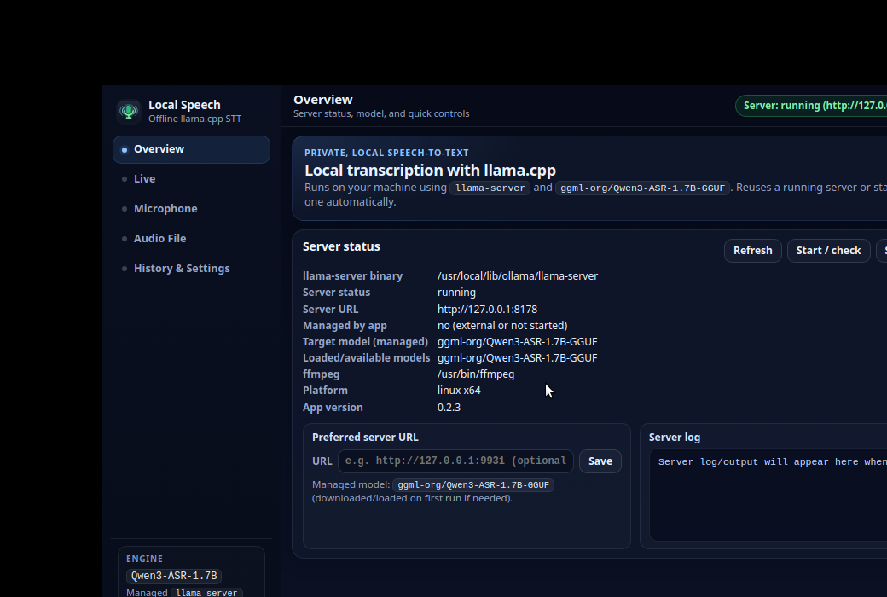

<div align="center">


# Local Speech

**Private, local speech-to-text for Linux — powered by llama.cpp**

Compact, frameless desktop app that runs speech recognition entirely on your machine using `llama-server` and the `ggml-org/Qwen3-ASR-1.7B-GGUF` model.

[](https://github.com/nirodg/local-speech-llama/releases/latest)
[](#requirements)
[](#how-it-works)

</div>

---

## Screenshot

<p align="center">
  
</p>

> Real screenshot of the app (Overview) running on Linux.

## Highlights

- **100% local transcription** — audio is processed by your local `llama-server` (llama.cpp), no cloud required.
- **Automatic server handling** — detects a running `llama-server` or starts a managed instance (`llama-server -hf ggml-org/Qwen3-ASR-1.7B-GGUF`) when needed.
- **Multiple input modes**
  - **Live dictation:** chunked near-realtime transcription with VAD/silence chunking and configurable auto-stop.
  - **Microphone:** record a take and transcribe it.
  - **Audio file:** transcribe a local audio file.
- **Floating listening widget** — when you minimize/hide the app while the mic is actively listening, a small always-on-top voice/analyzer widget stays visible so you get clear feedback that listening is in progress.

  <p align="center">
    
  </p>

- **Productive desktop UX** — compact frameless UI, tray integration (close hides to tray, **Show Local Speech / Start at login / Exit**), configurable default language and auto-stop silence, global hotkey, local history, copy/auto-copy and best-effort auto-paste.
- **Privacy-minded** — recordings are **not stored** (deleted after transcription; leftovers cleaned on launch).
- **Linux-ready packaging** — AppImage and `.deb` builds, with sandbox-safe launch flags baked in for compatibility.

## How it works

Local Speech talks to a local [llama.cpp](https://github.com/ggml-org/llama.cpp) HTTP server (`llama-server`) using Qwen3-ASR (`ggml-org/Qwen3-ASR-1.7B-GGUF`).

- If a compatible `llama-server` is already running, the app can reuse it (configurable preferred URL).
- Otherwise it can start a managed server for you.
- On first managed run, the model may be downloaded/loaded by `llama-server` (this can take time and requires network access once).

## Requirements

- **Linux** desktop environment
- **Node.js >= 18** and **npm** (for running from source / building)
- **`llama-server`** (llama.cpp) in `PATH` or at `/usr/local/lib/ollama/llama-server`
- **`ffmpeg`** (required for microphone/webm conversion)
- For best tray/hotkey/auto-paste behavior (environment-dependent): X11/Wayland tools such as `xdotool`, `wtype`, or `ydotool` may be used when available

## Download (recommended)

Grab the latest prebuilt Linux binaries from **[Releases](https://github.com/nirodg/local-speech-llama/releases/latest)**:

- **AppImage:** `Local Speech-<version>.AppImage`
- **Debian/Ubuntu package:** `local-speech_<version>_amd64.deb`

### Install / run

**Deb:**
```bash
sudo apt install ./local-speech_<version>_amd64.deb
# or
sudo dpkg -i ./local-speech_<version>_amd64.deb

local-speech
```

**AppImage:**
```bash
chmod +x "Local Speech-"*.AppImage
./"Local Speech-"*.AppImage
```

> The packaged builds include compatibility flags (`--no-sandbox --disable-setuid-sandbox --disable-gpu --disable-dev-shm-usage`) and the app also enforces sandbox-disabled startup internally. If you run an unpacked/dev binary manually and hit Chromium sandbox issues, launch with `--no-sandbox --disable-gpu`.

## Run from source

```bash
git clone https://github.com/nirodg/local-speech-llama.git
cd local-speech-llama
npm install
npm start
```

- `npm start` runs Electron with `--no-sandbox --disable-gpu` for compatibility.
- On first managed run, `llama-server -hf ggml-org/Qwen3-ASR-1.7B-GGUF` may download/load the model.

## Build Linux packages

A helper script is provided to build both **AppImage** and **deb** artifacts:

```bash
./scripts/build-linux.sh
```

Output:
- `dist/Local Speech-<version>.AppImage`
- `dist/local-speech_<version>_amd64.deb`

Manual build:

```bash
npm ci
npx electron-builder --linux AppImage deb
```

## Usage tips

- **Live dictation:** choose chunking/VAD mode and language, start listening, and stop manually or let silence auto-stop (configurable). Hotkey-triggered live sessions can auto-paste on stop.
- **Microphone / File:** record a take or pick an audio file to transcribe; results can be copied and are saved to local history.
- **Tray:** closing the window hides the app to tray. Use the tray menu for **Show Local Speech**, **Start at login**, and **Exit**.
- **Floating widget:** minimize/hide the app while listening to keep a visible microphone-activity indicator on screen.
- **History & Settings:** manage defaults (language, auto-stop), auto-copy/auto-paste, hotkey, and local transcript history.

## Troubleshooting

- **`chrome-sandbox ... is not configured correctly` / SUID sandbox errors:** use the latest packaged release (v0.2.2+ includes sandbox-disabled startup). If you enable the SUID sandbox manually, `chrome-sandbox` must be `root:root` with mode `4755` (local-user ownership is not valid) — but sandbox-disabled mode is the intended/default configuration for this app.
- **Model/server startup is slow on first run:** expected when `llama-server` downloads/loads the model via `-hf`.
- **Auto-paste/hotkeys don’t work:** depends on desktop environment/session (X11/Wayland) and available tools/permissions.
- **Transcription quality/performance:** depends on your `llama-server` build, hardware, and model/runtime settings.

## Privacy

- Transcription is performed locally via `llama-server`.
- Audio recordings are not retained by the app (deleted after transcription; leftover recording files are cleaned on launch).

## Credits

Made with <3 by [Brage Dorin](https://github.com/nirodg).
